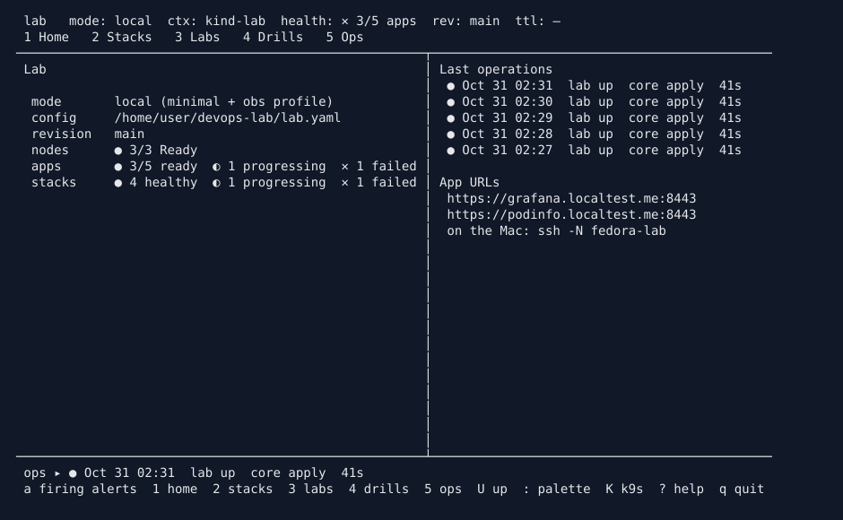
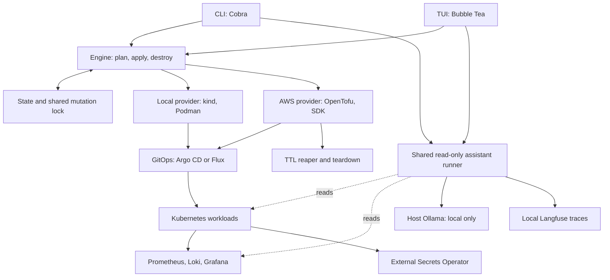

# devops-lab

A DevOps/SRE home lab driven by one Go binary, `lab`. It provides a CLI and a
Bubble Tea TUI over the same engine. Run Kubernetes locally with kind and
rootless Podman, or in AWS with EKS and short-lived resources.

After bootstrap, Argo CD owns workloads. Flux is the alternative; do not run
both outside the comparison lab. Labs teach deployment, observability and
recovery. Drills inject a bounded fault and restore saved state.

## TUI



This is the TUI's **100-column, 30-row golden test output**, not a live lab
screenshot. Its sample state deliberately includes progressing and failed
apps. Colours are stripped by the test; status symbols remain.
See [the source fixture](internal/tui/testdata/home_up.golden) and
[preview provenance and capture instructions](docs/tui-preview.md).

`lab` opens the TUI. Its **five implemented screens** use these keys:

| Key | Screen |
| --- | --- |
| `1` | Home |
| `2` | Stacks |
| `3` | Labs |
| `4` | Drills |
| `5` | Ops log |

`6` is reserved for a future Cost screen; it does not open a screen today.
`:` opens the command palette, `U` brings up the profile, and `K` opens k9s.
Each action logs its CLI command.
Mutating operations share one lock; another TUI opens read-only. Views remain
non-blocking. The first frame comes from cached state, with a 100 ms gate.
Logs retain 5,000 lines and redraw at most 20 times a second.

## Local quick start

Use a Linux workload host. The documented setup is Fedora with rootless
Podman, cgroup v2 and delegated controllers. Never use Docker.
Install Git, make, Go 1.27.1 or newer, kind, kubectl, Helm, jq and curl.
k9s is useful for the TUI handoff. See the
[host readiness checks](docs/design.md#what-lab-doctor-checks) and
[known host issues](prompts/91-known-issues.md).

The checked-in configuration is `minimal` plus `obs`, measured at about
4.6 GiB of container memory. Leave headroom for the host and builds.
NVIDIA/CDI and host Ollama are needed only for the optional local AI stack.
CI, chaos and local scaling are not implemented; planning reports unsupported
stacks as skipped rather than failing during apply.

```sh
git clone https://github.com/chanupen/devops-lab.git
cd devops-lab
git config core.hooksPath .githooks
export PATH="$HOME/.local/bin:$PATH"
make install
lab version
```

`make install` builds `bin/lab` and installs it in `~/.local/bin`, without sudo.
Use `make install BINDIR=/your/bin` for another location. It warns if that
location is not on PATH or another `lab` takes precedence.

Before starting, edit `lab.yaml`: set `repo.url` to your GitOps source and
`repo.sshKeyFile` to a **read-only deploy key** registered with that repository.
Keep the private key outside Git. The GitOps source must contain this repo's
`gitops/` tree on `main`; a plain `lab up` tracks `main`.

```sh
export KIND_EXPERIMENTAL_PROVIDER=podman
lab doctor
lab plan
lab up
lab status
lab
```

Review and fix doctor failures before `lab up`. Run these commands from the
checkout: config discovery tries `./lab.yaml`, then `~/.lab/lab.yaml`.
See [configuration and revision handling](docs/design.md#gitops-revision)
before using a different checkout or `--revision`.

App URLs use `https://<app>.localtest.me:8443`; `lab status` lists deployed
routes. The Gateway listens only on loopback, at ports 8080 and 8443.
TLS uses a lab CA; trust it explicitly rather than disabling verification.
For remote use, run the TUI over SSH and forward those loopback ports:

```sh
ssh -t lab-host lab
ssh -N -L 127.0.0.1:8080:127.0.0.1:8080 \
  -L 127.0.0.1:8443:127.0.0.1:8443 lab-host
```

Replace `lab-host` with your SSH host. Configure its `~/.lab/lab.yaml` as
described in the design so the remote TUI finds the checkout.
Quit the TUI before running `lab down` in another shell. `lab down` tears
down the local lab; the image cache volume is retained.

## Cloud mode and cost rules

**Cloud commands create or delete billed AWS resources. Review the plan and
get approval before apply or destroy.** Use
[the cloud session procedure](prompts/13-cloud-session.md), not an unattended
quick start. OpenTofu 1.10 or newer, AWS CLI and the account baseline are
required. The `lab` AWS profile assumes `lab-admin` with MFA; private baseline
inputs and credentials stay outside Git.

The baseline contains the state bucket, budget and TTL reaper. It is permanent:
`lab=true` and `owner`, but no `expires-at`. Do not teardown the baseline as
part of an ordinary lab session.

| Rule | Behaviour |
| --- | --- |
| Region and tags | `ap-south-1`; expiring resources carry `lab=true`, `owner=chanupen` and RFC 3339 `expires-at` |
| TTL | Default 2 hours; never more than 8 hours ahead, including `lab extend` |
| Reaper | Runs every 15 minutes; expired resources and teardown bundles are cleaned up server-side |
| Preflight | Refuses apply if the reaper is dry-run, its clean heartbeat is older than 30 minutes, teardown is running, or cleanup requires manual intervention |
| Budget | $30/month baseline default; alerts at 50/80/100%; the 100% action blocks new EC2 launches, not existing charges |
| Infrastructure | Spot nodes, no NAT gateway, no default load balancer, short log retention, gp3 storage |
| Access | `lab tunnel` forwards the Gateway to loopback; no LAN exposure |
| Cleanup | `lab down` releases external resources, destroys in reverse order, sweeps and checks real leftovers |

The default is **2h**, not 4h: `lab.yaml` sets `cloud.ttl: 2h`,
[`config.DefaultTTL`](internal/config/config.go) is two hours, and the AWS
provider consumes that configured duration through `Options.TTL`.
Override it with `cloud.ttl` or `lab up --mode cloud --ttl`; the 8h cap remains.

EKS control planes, nodes, volumes, registry and baseline services can cost
money. Review current prices before approval. Budgets and TTL are safeguards,
not a hard spending cap. Failed cleanup can continue billing.

After the baseline is configured and its safeguards pass:

```sh
lab cloud login
lab doctor --mode cloud
lab cloud plan
# After reviewing the plan and approving the apply:
lab up --mode cloud --ttl 2h
lab status --mode cloud
lab tunnel --mode cloud
# After approving teardown, in another shell once the tunnel is closed:
lab down --mode cloud
lab cloud leftovers
```

An empty real-leftovers list is the cleanup gate. Stale tagging-index entries
are listed separately and ignored after direct checks. Local and cloud state
live in `~/.lab/` and `~/.lab/cloud/`; their mutation lock is shared.
Cloud AI is an intentional stub, and drills are currently local only.
See [the complete guardrails](docs/design.md#cloud-mode-guardrails).

## Labs

Use `lab labs list`, then `lab labs start <id>`.
`lab labs verify`, `hint`, `solution`, `reset` and `stop` manage progress.
Main-cluster labs require their declared stacks; add them with
`lab up --stacks <comma-separated-stacks>`. Lab 1 uses an isolated scratch
cluster; other labs stay within their labelled objects and namespaces.

| Lab | Time | Level | Modes | Required stacks |
| --- | --- | --- | --- | --- |
| [01: Bootstrap Argo CD](labs/01-argocd-bootstrap/README.md) | 45m | Beginner | Local | Scratch cluster |
| [02: Build, scan and promote images](labs/02-image-promotion/README.md) | 40m | Intermediate | Local, cloud | registry, cluster |
| [03: SLO and burn-rate alerts](labs/03-slo-burn-rate/README.md) | 45m | Intermediate | Local, cloud | obs, sample-app |
| [04: Rotate database credentials](labs/04-secret-rotation/README.md) | 40m | Intermediate | Local, cloud | secrets, sample-db |
| [05: Require image digests with Kyverno](labs/05-kyverno-digest/README.md) | 35m | Intermediate | Local, cloud | policy |
| [06: Karpenter, PDBs and spot interruptions](labs/06-karpenter/README.md) | 50m | Advanced | Cloud | cluster |

Pass `--mode cloud` to lab commands for an approved cloud session.
[The lab format](labs/README.md) documents verify scripts and isolation.

## Drills

Drills run on the local main lab, one at a time, never while a lab is started.
They save snapshots before injecting faults and restore on recovery, abort
or expiry. All seven have a 30-minute limit.

| Drill | Level | Alert | Required stacks |
| --- | --- | --- | --- |
| [bad-deploy](drills/bad-deploy/README.md) | Beginner | KubePodCrashLooping | sample-app, obs |
| [oom](drills/oom/README.md) | Intermediate | KubeContainerOOMKilled | sample-app, obs |
| [dns](drills/dns/README.md) | Intermediate | CoreDNSDown | sample-app, obs |
| [cert-expiry](drills/cert-expiry/README.md) | Intermediate | CertificateExpiringSoon | sample-db, obs |
| [node-loss](drills/node-loss/README.md) | Intermediate | KubeNodeNotReady | sample-app, obs |
| [slow-db](drills/slow-db/README.md) | Advanced | SampleDBLatencyFastBurn | sample-db, obs |
| [secret-drift](drills/secret-drift/README.md) | Intermediate | ExternalSecretSyncFailed | secrets, sample-db, obs |

Use `lab drills list`, `start <id>`, `status`, `ack <cause>`, `verify` and
`abort`. On TUI screen 4, `a` investigates, `A` acknowledges a cause, and
`x` aborts. Esc cancels the assistant, **not the drill**.
After any interrupted run, finish with `lab drills abort` and confirm
`lab drills status` reports nothing active. See [drill safety](drills/README.md).

## AI On-Call Assistant

The optional local `ai` stack uses **host Ollama**, not a second runtime in
kind, and Langfuse for local traces. Set up the
[pinned Quadlet and GPU access](docs/design.md#ai-stack-local-only), then add
the stack with `lab up --stacks ai`. The default assistant model is
`llama3.2:3b`.

CLI, Alertmanager webhook and TUI use the same read-only runner. It gathers
pod status, events, Loki logs, Prometheus samples and Argo CD history.
The pane shows its rule candidate, note and cited evidence. Every note is
labelled **hypothesis, needs human review**. Valid citation IDs do not prove
that a claim is supported, and suggested commands are never executed.
Missing causal evidence is an abstention, not a confident guess.

On Home, `a` lists firing alerts; select one and press `a` or Enter.
On Drills, `a` investigates the running drill. Esc cancels the request.
For the CLI, use `lab assist alert <name> --rules-first` or
`lab assist drill <id> --rules-first` for an already-running drill.
Pass `--langfuse-ca /path/to/lab-ca.pem` if the Gateway CA is not trusted.

**Recorded fixture results from #40:** three runs per case, five diagnosable
drills; expected abstentions are scored separately.

| Model | Model-only cause accuracy | Rules-first cause accuracy | Rules-first evidence support |
| --- | --- | --- | --- |
| Llama 3.2 3B | 0/15 (0%) | 15/15 (100%) | 60.0% |
| Qwen2.5 3B, eval comparison only | 0/15 (0%) | 15/15 (100%) | 64.2% |

**The rules were authored against these fixtures. The 100% score measures
the harness and plumbing, not generalisation.** This ten-case recording is
not a benchmark of the later live-bad-deploy fixture or a held-out result.
slow-db, secret-drift and three seeded uncertainty cases each had 3/3 expected
abstentions per model and mode; they are not wrong causal diagnoses.
Evidence support is lower than cause accuracy and still needs human review.

Qwen2.5 3B is **non-commercial research only**, used solely as an eval
comparison, never a default assistant model or bundled model. Its terms differ
from some larger Qwen variants. See [model licences](docs/licences.md).
For an explicitly Llama-only replay:

```sh
lab assist eval --models llama3.2:3b --runs 3
```

Keep held-out recordings in a separate fixture directory not used to write or
tune rules, and pass `--fixtures /path/to/held-out`. Eval holds the shared lock.
Hosted inference requires an explicit per-run CLI flag and warns that selected
cluster evidence leaves the host. Neither the webhook nor TUI can enable it.
Redaction is bounded protection, not proof that logs contain no sensitive data.
See [the assistant design](docs/design.md#ai-on-call-assistant-local-only).

## Architecture



Mode differences belong in `internal/provider/` and `gitops/overlays/`.
The [design document](docs/design.md) covers dependency order, state,
GitOps ownership, TUI behaviour and cleanup guarantees.

## Development and release status

`make lint test` runs golangci-lint and race tests in both Go modules.
`make build-all` builds linux/amd64 and darwin/amd64 binaries.
E2E labs and drills have separate opt-in commands in their READMEs; they
mutate a lab and are not part of the unit suite.

There is no v1.0.0 release yet. The [release workflow](.github/workflows/release.yml)
builds linux/amd64 and darwin/amd64 on `v*` tags, after lint and race tests.
It verifies SHA256SUMS, retains repository and linked-module notices, and
publishes a GitHub release using only GITHUB_TOKEN. A release commit must be
reachable from `main`; a draft is made public only after all assets upload.
A live walkthrough has not been recorded;
the preview above is deliberately a golden fixture, not an invented demo.
See [build status](prompts/README.md).

### Verify downloaded binaries

Download the binary for your platform and `SHA256SUMS` from the **same
GitHub release**. Check before running or installing it.

Linux:

```sh
sha256sum --check --ignore-missing SHA256SUMS
chmod u+x lab-linux-amd64
./lab-linux-amd64 version
```

Intel macOS:

```sh
grep '  lab-darwin-amd64$' SHA256SUMS | shasum -a 256 --check
chmod u+x lab-darwin-amd64
./lab-darwin-amd64 version
```

Stop if verification fails. A checksum detects corruption; it is not an
independent signature if the binary and checksum source are both compromised.
The release also includes `LICENSE` and `THIRD_PARTY_NOTICES.txt`; retain them.
Source installation with `make install` remains available as described above.

For a branch-only workflow probe, dispatch the workflow without creating a tag:

```sh
gh workflow run release.yml --ref ci/release-pipeline
```

Replace the branch name with the branch to test. It runs the same
checks/build/checksum steps and uploads the `lab-release` Actions artifact,
with the commit SHA as the binary version, but **never runs the
release-publishing job**. Only a push of a `v*` tag can publish.
Do not use a `v*` tag as a test or push v1.0.0 before release approval.

Repository code and documentation are [MIT-licensed](LICENSE), copyright
2026 chanupen. Third-party software and model terms remain separate.
The [public-readiness audit](docs/public-readiness.md) and
[component licence inventory](docs/licences.md) record findings and remaining
redistribution caveats. Historical hostnames remain in history by decision;
no secrets or history rewrite are authorized.
