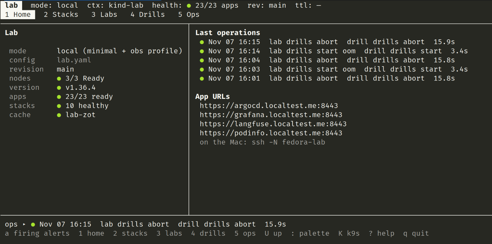

# devops-lab

A DevOps/SRE home lab driven by one Go binary, `lab`. The CLI and Bubble Tea
TUI share an engine. Run Kubernetes locally with kind and rootless Podman,
or in AWS with EKS and expiring resources.

After bootstrap, Argo CD owns workloads. Flux is planned, not built.
Six labs teach deployment, observability and recovery. Seven local drills
inject bounded faults and restore saved state.

## Start here

| Goal | Guide |
| --- | --- |
| Run on a Linux host | [Local getting started](docs/getting-started/local.md) |
| Use an approved AWS session | [Cloud getting started](docs/getting-started/cloud.md) |
| Understand the shared engine and GitOps | [Architecture](docs/concepts/architecture.md) |
| Find exercises, known issues or release checksums | [Documentation index](docs/README.md) |

The default local config is `minimal` plus `obs`, measured at about 4.6 GiB
of container memory. GPU and Ollama are optional for the local AI stack.
Its assistant provides read-only hypotheses that need human review.

**Safety:** rootless Podman only, never Docker. Keep listeners on loopback.
Cloud stays in `ap-south-1`, defaults to a **2h TTL**, and needs approval before
apply or destroy. TTL and budget alerts are not a hard spending cap.
Credentials, kubeconfigs and infrastructure state stay outside Git.
The repository remains private.

## TUI



The [golden fixture](internal/tui/testdata/home_up.golden) still backs the renderer test.

`lab` opens five screens: `1` Home, `2` Stacks, `3` Labs, `4` Drills and
`5` Ops. `6` is reserved, not implemented. `?` shows key help; `q` quits
without destroying the lab. Each action logs its CLI equivalent.
Mutations share one lock; another TUI opens read-only and views stay responsive.

## Demo

[Recorded TUI session](docs/assets/lab-demo.cast): 38 seconds, under 1 MB.
Download it and replay with asciinema 3:

```sh
asciinema play docs/assets/lab-demo.cast
```

**What you will see:** the recorded terminal session; replay does not run its commands.
Run playback in a terminal, not an output pipe.
Shell identifiers were removed; see [capture provenance](docs/tui-preview.md).

## Install and develop

On Linux, from the checkout with Go 1.27.1+ and the prerequisites in the
[local guide](docs/getting-started/local.md):

```sh
make install
```

**What you will see:** the installed path and version. The default is `~/.local/bin/lab`,
without sudo; `BINDIR` changes the destination. Installation does not start a lab.

```sh
make lint test
```

**What you will see:** offline documentation checks, golangci-lint and race-test results for both Go modules.
Opt-in e2e tests mutate a lab and are not part of this command.
Documentation checks need Python 3.10+ and make, with no downloads or secrets.

[v1.1.0](https://github.com/chanupen/devops-lab/releases/tag/v1.1.0) is the current
release ([changes](CHANGELOG.md)). Linux/amd64 and Intel macOS binaries come with `SHA256SUMS`;
[verify your download](docs/README.md#release-binaries) before executing it.
The [release workflow](.github/workflows/release.yml) builds tagged releases.
Branch-only dispatch builds artifacts without publishing.

[Engineering reference](docs/design.md) · [Build status](prompts/README.md) ·
[MIT licence](LICENSE) · [Component and model terms](docs/licences.md)
