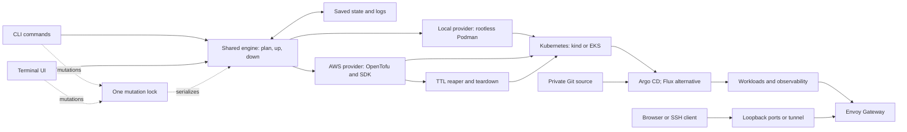

# How the lab fits together

[Docs index](../README.md) · [Local guide](../getting-started/local.md) ·
[Cloud guide](../getting-started/cloud.md)

`lab` is one Go binary with a CLI and a terminal UI. They use the same
engine, configuration and saved state. Local and cloud are providers,
not separate products.

## What an up does

1. Read `lab.yaml` and the state for the selected mode.
2. Order stacks by their dependencies. A stack is a named group, such as
   `registry`, `core` or `obs`. Skip stacks the provider cannot run.
3. Create infrastructure through the provider and bootstrap the GitOps controller.
4. Let GitOps reconcile the requested workloads from Git. Record progress and logs.

The registry precedes the cluster; GitOps follows the cluster.
Core provides metrics-server, cert-manager and the Gateway.
The sample app depends on core; observability adds Prometheus, Grafana and
other telemetry services. Dependencies are added when you request a stack.

After bootstrap, change workload definitions through GitOps, not competing
manual installs. Argo CD is the default. Flux is the alternative, not an
extra controller to run beside it.

## What changes between modes

| Capability | Local | Cloud |
| --- | --- | --- |
| Cluster | kind on rootless Podman | EKS with spot capacity and Karpenter |
| Registry | Zot, also an image cache | ECR |
| AWS APIs for exercises | Moto emulator | Real AWS APIs |
| Workload definitions | Local GitOps overlay | Cloud GitOps overlay |
| App access | kind publishes loopback 8080/8443 | A loopback port-forward; no default load balancer |
| Expiry | Operator controls teardown | TTL tags and server-side reaper |
| AI | Optional host Ollama and in-cluster tracing | Intentional stub |

The loopback URL shape stays `https://<app>.localtest.me:8443`.
An SSH client forwards the Linux host's loopback ports; the Gateway never
needs to listen on the LAN.

## State is not the cluster

Local state is `~/.lab/state.json`; cloud state is `~/.lab/cloud/state.json`.
Their kubeconfigs live alongside them, not in `~/.kube/config`.
State records what the engine applied. Status also reads live Kubernetes
health, so an applied stack can still have unhealthy applications.

Mutating commands share a lab lock across modes. A TUI that cannot get it
opens read-only. Views and read-only CLI reports remain non-blocking.
Quit a mutating TUI before changing the lab from another terminal.

Never delete state as a repair. It carries operation history and drill
snapshots; cloud teardown also relies on separate infrastructure state and
uploaded cleanup bundles.

## What a down does

Local down removes dependents before their dependencies. It retains the
registry cache volume unless separately asked to purge it.

A full cloud down releases resources that outlive Kubernetes, destroys
the environment and sweeps/checks leftovers. The permanent account baseline
stays. The TTL reaper is an independent fallback if the operator loses access;
it is not a hard spending cap or a substitute for confirming cleanup.

## Keep learning

Use the getting-started guides for the runnable sequences. The
[engineering reference](../design.md) has implementation details and measured
resource budgets. Labs and drills build on this platform; they do not require
a second CLI or a second GitOps controller.
